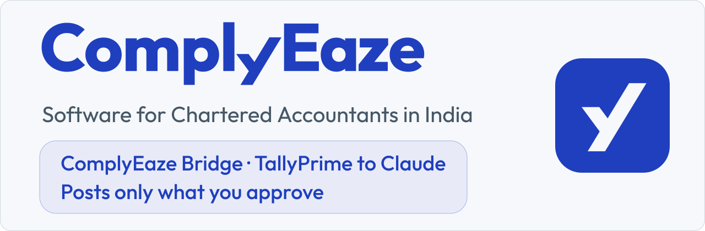

  <a href="https://bridge.complyeaze.com">
    <picture>
      <source media="(prefers-color-scheme: dark)" srcset="banner-dark.svg">
      <source media="(prefers-color-scheme: light)" srcset="banner-light.svg">
      
    </picture>
  </a>

**ComplyEaze Bridge** is a Claude Desktop extension (`.mcpb`), a Model Context Protocol (MCP) server, that lets Claude, Anthropic's AI assistant, read the TallyPrime books on your own computer, and post a voucher only after a person approves it. It is for Chartered Accountants, accountants and firms in India, on Windows x64 and Apple Silicon Macs. On a Mac, TallyPrime has to be reachable on that Mac, for example in a Windows virtual machine; the install guide explains.

  <a href="https://github.com/ComplyEaze/bridge/blob/master/docs/agent/INSTALL.md">Install ComplyEaze Bridge</a>
  &nbsp;·&nbsp;
  <a href="https://github.com/ComplyEaze/bridge">Source code</a>
  &nbsp;·&nbsp;
  <a href="https://bridge.complyeaze.com">ComplyEaze Bridge website</a>
  &nbsp;·&nbsp;
  <a href="https://github.com/ComplyEaze/bridge/security/advisories/new">Report a security issue</a>

ComplyEaze Bridge is made by SPMS Comply Eaze Solutions LLP (ComplyEaze), an Indian LLP. Its source code is open under the Apache-2.0 licence; the ComplyEaze names and logos are not licensed with it.

## Using it with client books

- **Where your data goes.** The extension talks only to the TallyPrime on your own computer, and nothing in that path copies your books to a ComplyEaze server. What Claude reads goes to its AI provider under your account, including amounts and company names. You can mask party names or drop narration; amounts are never removed.
- **Posting is off by default.** Once you turn it on, it posts one Journal, Payment, Receipt or Contra voucher at a time, using ledgers that already exist. A person approves each voucher in a dialog on your computer, and the assistant cannot approve it. It makes one attempt, never retries automatically, and reads the voucher back afterwards.
- **What it cannot do.** It has no tool to delete or undo a voucher it has posted, so a wrong post has to be corrected by hand in TallyPrime. In the moment after its checks, a different company renamed to the target's name, or a ledger replaced under the same name, could receive the voucher instead, and ComplyEaze Bridge may not be able to say where it went. It needs books with a single currency, INR. Leave posting off unless you accept those risks.
- **A local record.** Every tool call, read or write, succeeded or refused, adds an entry to a log on your own computer, naming the company it touched, with fingerprints of the request and the response.

## What it reads and prepares

- **Reads:** companies, ledgers and their group chains, trial balance, vouchers in a date window, outstandings with ageing, ledger movement and GSTIN history. It also checks that a voucher's ledgers exist.
- **Prepares:** voucher import files, and bank statements parsed from PDF (State Bank of India, HDFC Bank and Union Bank of India statements).

## What a CA can ask

With ComplyEaze Bridge installed, ask Claude:

- *"Show the trial balance for FY 2025-26."*
- *"Which parties have outstanding receivables, largest first?"*
- *"List the Payment vouchers dated 1 to 15 July 2026."*
- *"How did the Bank Charges ledger move in June 2026?"*

## Status, honestly

Not yet run by us in a controlled test: posting with a published package against a live TallyPrime, the approval window on Windows, posting on TallyPrime Education, and posting on TallyPrime Gold with its approval step recorded. Reported by the owner, with no logs kept: the published 0.3.0 package was used on Windows x64 in Claude Desktop for reads only, against a live TallyPrime Gold book, on 28 September 2026. Releases are not code-signed or notarized; each download is published with a SHA-256 checksum and a provenance file.

## Contact

- General: [contact@complyeaze.com](mailto:contact@complyeaze.com)
- Security reports: use [GitHub private vulnerability reporting](https://github.com/ComplyEaze/bridge/security/advisories/new), or write to [security@complyeaze.com](mailto:security@complyeaze.com), privately rather than in a public issue

---

ComplyEaze and ComplyEaze Bridge are the names and marks SPMS Comply Eaze Solutions LLP uses to identify its products; they are not registered trade marks. TallyPrime is a trade mark of Tally Solutions Pvt. Ltd. Claude is a trade mark of Anthropic. ComplyEaze is not affiliated with, or endorsed by, Tally Solutions Pvt. Ltd. or Anthropic. Bank names are used only to identify the bank statement formats ComplyEaze Bridge reads; ComplyEaze is not affiliated with, or endorsed by, any of them.
